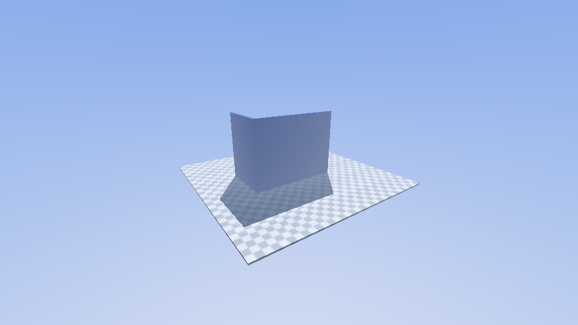

# Scene: flat (default)

A flat platform exactly **one voxel thick**, covering the whole world
horizontally, a quarter of the way up (voxel layer `floor(0.25 / voxel)`).
It stays one voxel thick at any `--depth`.

Two **blue grip walls** (2 voxels thick, up to y = 0.62) stand on it to test
wall-walking:

- **Wall 1**: the plane x = 0.60, facing −x (toward the spawn point),
  z from 0.30 to 0.77.
- **Wall 2**: the plane z = 0.75, facing −z, x from 0.35 to 0.61:
  perpendicular to wall 1 and meeting it in an inner corner, so the route is
  ground → wall 1 → wall 2.

Colours: light grey / blue-grey checkerboard in 4×4-voxel squares on the
platform, blue on the grip walls, ±3% per-voxel noise.

