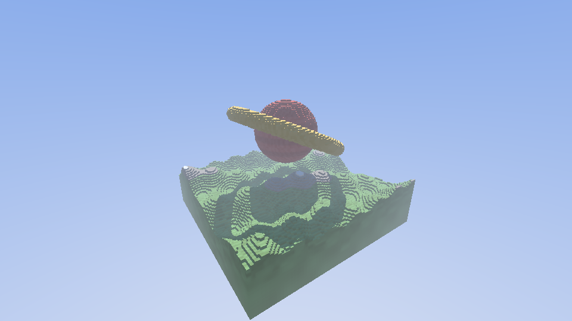

# Scene: island (saved)

The first world of the project, kept exactly as it was rendered: the
octree built from this file is byte-identical to the original.

```
octree_render --scene island            # walk on it
octree_render --scene island --fly      # fly around it
```



## Map (geometry, in [0,1]^3)

- **Terrain**: height field
  `0.22 + 0.050·sin(7x)·cos(6z) + 0.025·sin(19x + 4z) + 0.012·cos(41z − 13x)`,
  solid below it (SDF scaled by 0.45 to stay a safe distance bound).
- **Sphere**: centre (0.5, 0.5, 0.5), radius 0.17, floating above the terrain.
- **Ring**: torus around the sphere, major radius 0.29, tube radius 0.035,
  tilted (cos 0.92 / sin 0.39 rotation about x).

## Textures (voxel colours)

Every voxel gets ±6% brightness noise from a hash of its position
(`x·73856093 ^ y·19349663 ^ z·83492791` at 4096 steps per unit).

| Material | Colour (RGB 0–1) |
|---|---|
| Grass (low terrain) | 0.30, 0.55 − 0.1·h, 0.22 |
| Rock (h > 0.62) | 0.50, 0.46, 0.42 |
| Snow (h > 0.82) | 0.92, 0.93, 0.96 |
| Sphere | 0.80, 0.22, 0.18, with darker horizontal stripes (×0.8 where sin(90·(y − 0.5)) < 0) |
| Ring | 0.95, 0.72, 0.25 (gold) |

`h` = terrain altitude normalised as clamp((y − 0.13) / 0.20, 0, 1).

The source of truth is `island.cpp` in this folder.
